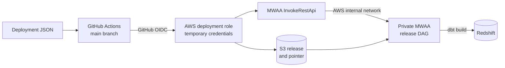

# GitHub to AWS access



## GitHub deployment role

GitHub uses OIDC to assume the role from the deployment JSON. AWS returns
temporary credentials; no long-lived AWS keys are stored in GitHub.

Restrict the role trust to this repository's actual OIDC subject for `main`:

```text
repo:<organization>/<repository>:ref:refs/heads/main
```

Required permissions:

- `s3:GetObject` and `s3:PutObject` on
  `arn:aws:s3:::exerp-<system>-dataflow-airflow/dbt_project/*`.
- `airflow:InvokeRestApi` and, for private MWAA,
  `airflow:CreateWebLoginToken` on
  `arn:aws:airflow:<region>:<account-id>:role/<system>-dataflow-airflow/<airflow-role>`.
- KMS permissions when the S3 bucket uses a customer-managed key.

`InvokeRestApi` works with a private MWAA webserver: AWS forwards the request
internally, so GitHub needs no inbound VPC access.

The MWAA execution role is separate and is documented in
[Automatic MWAA releases](automatic-release-dag.md).
